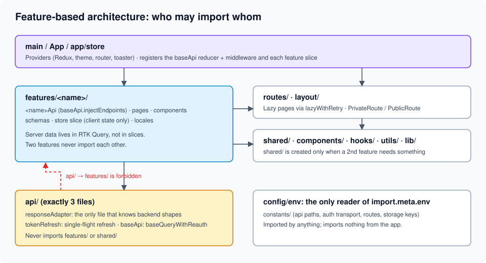
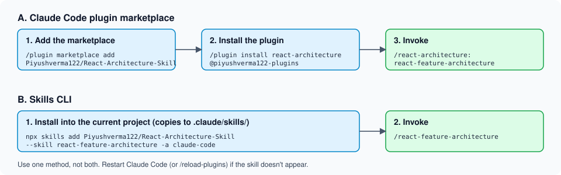

# React-Architecture-Skill

[](https://skills.sh/Piyushverma122/React-Architecture-Skill)

A Claude Code skill that builds, completes, and extends **Vite + React** apps (JavaScript or TypeScript) with a feature-based architecture and a production-style auth layer: RTK Query, single-flight token refresh, session restore, guarded routes, lazy loading with retry, and a verification step that runs your project's real build, lint, type check, and tests.

It does not paste a boilerplate over your project. It inspects first, proposes a plan, waits for your approval, changes only what you approved, and reports what it actually verified.



## Why use it

- **Consistent structure.** Business code lives in self-contained `features/`. Server state lives only in RTK Query. Every project gets the same import-direction rules.
- **Auth that handles the hard cases.** One refresh path, single-flight, at most one retry per request, session restore on reload, and redirects that can't be used for open-redirect attacks.
- **Works with your project.** If the project already has a router, theme provider, or i18n setup, the skill keeps it and adapts to it.
- **Honest verification.** It runs your package manager's build, lint, type check, and tests, and reports real results. It never claims something passed that it didn't run.
- **Asks instead of guessing.** For example, it always asks whether your backend sends the refresh token in an httpOnly cookie or the response body.

**Stack:** Vite · React · Tailwind CSS v4 · shadcn/ui · Redux Toolkit + RTK Query · react-router · react-hook-form + zod · sonner · i18next.

## Setup mode vs Extend mode

| | **Setup mode** | **Extend mode** |
|---|---|---|
| When | Empty folder, a React app that doesn't follow the architecture yet, or one that follows it only partly | Architecture items 1–16 are all present and match (a missing `CLAUDE.md` alone doesn't force Setup; the skill offers to write it) |
| What it does | Inspects, proposes, then scaffolds, adopts, or completes the missing infrastructure (only what's missing) | Adds one feature: API slice, pages, schemas, lazy route, locale namespace |
| Asks you | Refresh-token transport, token persistence, and only the choices inspection couldn't settle | Usually nothing; it follows the project's `CLAUDE.md` |
| Ends with | Verification results plus a list of backend settings you still need to configure | Build, lint, type check, and test results |

If the project is ambiguous, the skill asks which mode applies instead of guessing. See [workflow diagrams](docs/diagrams.md#setup-vs-extend-workflow).

## Architecture at a glance

```
src/
├── app/          store wiring only
├── api/          exactly 3 files: responseAdapter, tokenRefresh, baseApi
├── config/       the only reader of import.meta.env
├── features/     self-contained business code (auth, home, <your features>)
├── shared/       code a second feature needs (created only when needed)
├── components/   ui (shadcn output), loaders
├── routes/       AppRoutes, PrivateRoute, PublicRoute
├── layout/       Layout, Header, Sidebar, AppToaster ...
├── utils/        lazyWithRetry, getSafeRedirect, storage ...
└── locales/      en, hi
```

The full folder tree, import-direction rules, and "where does this file go?" order are in [architecture.md](skills/react-feature-architecture/references/architecture.md).

## JavaScript and TypeScript

Both are supported. JS projects use [code-templates.md](skills/react-feature-architecture/references/code-templates.md) and TS projects use [typescript.md](skills/react-feature-architecture/references/typescript.md). The architecture and behavior are identical; only the file extensions and types differ. In a mixed project the skill asks which to use.

## Authentication and security

- Login, logout, current user, session restore on reload, and session expiry handling.
- Automatic refresh on 401 through one **single-flight** path, shared by every caller, with at most one retry per request.
- Refresh token transport is **your choice**: httpOnly cookie (recommended when the backend supports it) or response body.
- Access token in memory by default. Persistence is opt-in, after the skill explains the risk.
- Safe post-login redirects: same-origin only, parsed with the URL parser, `/login` blocked.
- No tokens, passwords, or auth responses in logs. Refresh tokens never go into Redux or the RTK Query cache.

Details, the expected backend contract, and the trade-offs: [auth-and-security.md](skills/react-feature-architecture/references/auth-and-security.md). Flow diagram: [docs/diagrams.md](docs/diagrams.md#authentication-flow).

## Install

You can install through the Claude Code plugin marketplace or through the Skills CLI. Pick one, not both (see [Troubleshooting](#troubleshooting)).

### Installation via Claude Code Plugin Marketplace

Inside Claude Code:

```text
/plugin marketplace add Piyushverma122/React-Architecture-Skill
/plugin install react-architecture@piyushverma122-plugins
```

On Claude Code 2.1.275 or later, one command adds the marketplace and installs the plugin:

```text
/plugin install react-architecture --marketplace Piyushverma122/React-Architecture-Skill
```

From a terminal:

```bash
claude plugin marketplace add Piyushverma122/React-Architecture-Skill
claude plugin install react-architecture@piyushverma122-plugins
```

The default scope is `user`. To share the plugin with a team through the repo's `.claude/settings.json`, add `--scope project` to both commands.

Restart Claude Code (or run `/reload-plugins`), then check that it loaded with `/plugin list`.

### Installation via Skills CLI

Install only the skill with the [Skills CLI](https://skills.sh/docs/cli):

```bash
npx skills add Piyushverma122/React-Architecture-Skill --skill react-feature-architecture -a claude-code
```

This copies the skill into your project's `.claude/skills/` folder. Invoke it as `/react-feature-architecture`. The CLI collects anonymous install telemetry by default; set `DISABLE_TELEMETRY=1` to opt out ([details](https://skills.sh/docs/cli)).

Listing: [skills.sh/Piyushverma122/React-Architecture-Skill](https://skills.sh/Piyushverma122/React-Architecture-Skill)



## Use

The skill triggers from requests like:
- "Set up a new React project with feature-based architecture"
- "Add a posts feature to this app"
- "Set up login with refresh tokens"

You can also invoke it directly:

| Installed through | Command |
|---|---|
| Plugin marketplace | `/react-architecture:react-feature-architecture` |
| Skills CLI | `/react-feature-architecture` |

Worked prompts with the expected workflow and output for setup, extend, a new feature, auth, RTK Query, JS, and TS are in [docs/examples.md](docs/examples.md).

## What has been verified

These results come from the verification notes in the reference files (run on 2026-11-06). They show the templates compile and behave as tested. They do **not** prove the templates work against your backend, so the skill re-runs your project's own checks every time.

- **JavaScript templates:** extracted verbatim into a fresh `create-vite@9.3.4` React app with shadcn CLI 4.23 (`radix-vega`). They passed `vite build`, `oxlint`, and the Vitest suite in [testing.md](skills/react-feature-architecture/references/testing.md).
- **TypeScript templates:** the typed files were checked with TypeScript 7.0.2 (`tsc --noEmit`) under `strict`, `verbatimModuleSyntax`, `noUnusedLocals`, `noUnusedParameters`, and `erasableSyntaxOnly`, and the same Vitest suite passed. Files covered only by the conversion rules were not individually type-checked as `.tsx`.
- **Packaging:** `claude plugin validate . --strict` passes (the only warning is a missing plugin icon). Installing the plugin from GitHub and running the skill by its slash command worked in an isolated config directory, and so did installing through the Skills CLI.
- **Not tested:** whether Claude triggers the skill automatically from a plain-language request in every setup.

## Known limitations

- **Vite SPA only.** For Next.js, Remix / React Router framework mode, or CRA/webpack projects, the skill stops and asks instead of applying the architecture as-is.
- **A refresh endpoint is required.** If your backend has none, the skill stops and discusses a reduced design with you.
- **Multiple tabs:** each tab restores its own session. With strict refresh-token rotation and reuse detection, two tabs refreshing at the same moment can trip the detector. Cross-tab coordination isn't included by default.
- **Logout in another tab** isn't propagated until that tab's next 401.
- **Cookie mode** always makes one refresh call at startup, even for visitors who never logged in. That's expected.
- Template library versions drift. Always rely on the checks the skill runs in your project.

The full list is in [auth-and-security.md §8](skills/react-feature-architecture/references/auth-and-security.md).

## Troubleshooting

| Problem | Fix |
|---|---|
| "This source has no marketplace file" when adding the marketplace | The repository needs `.claude-plugin/marketplace.json` on its default branch. This repo has it; make sure you typed `Piyushverma122/React-Architecture-Skill` exactly. |
| The skill doesn't show up after installing | Restart Claude Code or run `/reload-plugins`, then check `/plugin list`. For the Skills CLI, run `npx skills list` in the project where you installed it. |
| The slash command isn't found | The command depends on how you installed it (see the table under [Use](#use)). |
| The skill appears twice | You installed it through both methods. Uninstall one. |
| The skill stops and asks about my stack | Expected for Next.js, Remix, and CRA/webpack projects. See [Known limitations](#known-limitations). |
| The skill asks about the refresh token | Intentional. It never assumes cookie vs body. Decide with your backend team using [auth-and-security.md §4](skills/react-feature-architecture/references/auth-and-security.md). |
| Auth doesn't work against my API | The templates use placeholder endpoint paths and response shapes. The final report lists what to set in `constants/api` and `api/responseAdapter`. |

Still stuck? [Open an issue](https://github.com/Piyushverma122/React-Architecture-Skill/issues/new/choose).

## Update

```bash
claude plugin marketplace update piyushverma122-plugins
claude plugin update react-architecture@piyushverma122-plugins
```

Inside Claude Code, use `/plugin marketplace update piyushverma122-plugins` instead. Restart Claude Code after updating. If you installed through the Skills CLI, run `npx skills update`.

## Uninstall

```bash
claude plugin uninstall react-architecture@piyushverma122-plugins
claude plugin marketplace remove piyushverma122-plugins
```

## Contributing

Issues and pull requests are welcome. Read [CONTRIBUTING.md](CONTRIBUTING.md) first; the most useful contributions are bug reports from real projects, verified template fixes, and new reference material. Please follow the [Code of Conduct](CODE_OF_CONDUCT.md), and report security issues as described in [SECURITY.md](SECURITY.md).

## Repository layout

```
.claude-plugin/
  marketplace.json      # marketplace "piyushverma122-plugins" (plugin source: "./")
  plugin.json           # plugin "react-architecture" (version, author, license)
skills/
  react-feature-architecture/
    SKILL.md            # the skill: workflow, phases, non-negotiables
    references/         # architecture, templates (JS/TS), auth & security, testing, checklist
docs/                   # diagrams, worked examples, images
scripts/                # repository validation used by CI
```

The repository root is both the marketplace and the plugin.

## Releasing a new version (maintainer)

1. Make your changes under `skills/`.
2. Bump `version` in `.claude-plugin/plugin.json`. The marketplace entry deliberately has no `version`, so `plugin.json` is the single source of truth.
3. Validate: `claude plugin validate . --strict`.
4. Commit and push, then optionally tag the release: `claude plugin tag . --push`.

Users pick up the release with the update commands above.

To test locally without GitHub:

```bash
claude plugin marketplace add ./path/to/React-Architecture-Skill
claude plugin install react-architecture@piyushverma122-plugins
```

## License

[MIT](LICENSE)
