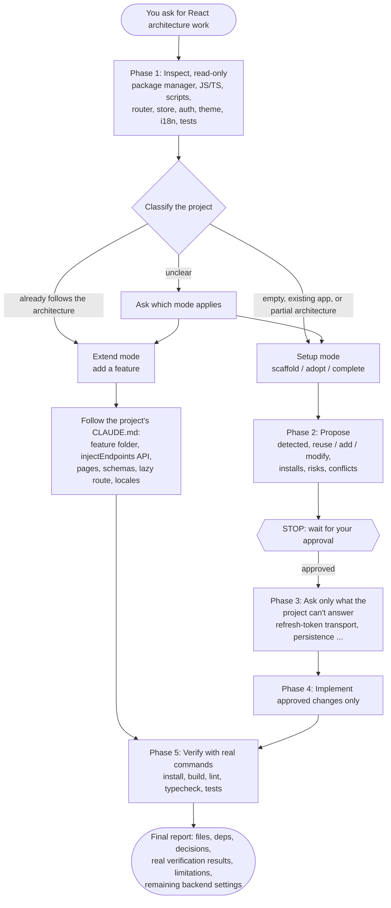
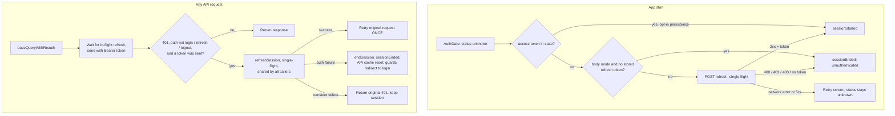

# Diagrams

Editable Mermaid sources, rendered by GitHub. The architecture overview and installation workflow are SVGs in [`assets/`](assets/).

- [Setup vs Extend workflow](#setup-vs-extend-workflow)
- [Authentication flow](#authentication-flow)
- [Architecture overview (SVG)](assets/architecture-overview.svg)
- [Installation workflow (SVG)](assets/installation-workflow.svg)

## Setup vs Extend workflow

Both modes share the same gate: **nothing is changed before you approve the proposal**.

## Authentication flow

Summarized from [auth-and-security.md §2](../skills/react-feature-architecture/references/auth-and-security.md).

Redirects have one source of truth: the route guards react to `auth.status`, and every redirect goes through `getSafeRedirect`. No component calls `navigate()` after login or logout.
